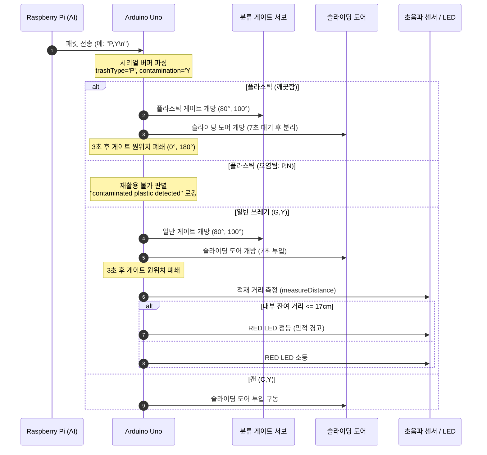

# 🤖 Arduino Firmware & Hardware Control Subsystem

> **스마트 쓰레기 자동 분류 시스템의 메카트로닉스 구동 및 센서 제어 펌웨어**  
> AI 비전 인식 결과에 따라 서보모터를 정밀 제어하여 쓰레기를 올바른 투입구로 분류하고, 초음파 센서로 쓰레기통의 적재량을 실시간 모니터링합니다.

---

## 📌 목차
1. [시스템 개요](#-시스템-개요)
2. [하드웨어 구성 및 핀 맵 (Pinout)](#-하드웨어-구성-및-핀-맵-pinout)
3. [동작 시퀀스 및 제어 로직](#-동작-시퀀스-및-제어-로직)
4. [통신 프로토콜 (Serial Protocol)](#-통신-프로토콜-serial-protocol)
5. [🛠️ 핵심 트러블슈팅: 통신 인터페이스 전환기](#-핵심-트러블슈팅-통신-인터페이스-전환기)
6. [빌드 및 업로드 가이드](#-빌드-및-업로드-가이드)
7. [담당 역할 및 기여도](#-담당-역할-및-기여도)

---

## 📖 시스템 개요

본 서브시스템은 Raspberry Pi의 AI 엣지 디바이스로부터 판별 결과(쓰레기 종류 및 오염 여부)를 시리얼 통신으로 전달받아, 하드웨어 액추에이터를 통해 물리적 분류를 수행합니다.

- **분류 게이트 제어**: 일반 쓰레기(General) 및 플라스틱(Plastic) 전용 양문형 서보 게이트 제어
- **슬라이딩 도어 구동**: 쓰레기 투입구를 열고 닫는 메인 슬라이딩 서보모터 구동
- **적재량 모니터링**: HC-SR04 초음파 센서로 내부 적재 높이를 주기적으로 측정하여 만적 시 LED 경고 출력

---

## 🔌 하드웨어 구성 및 핀 맵 (Pinout)

### 1. 주요 부품 목록
| 부품명 | 수량 | 역할 |
|---|:---:|---|
| **Arduino Uno R3** | 1 | 메인 마이크로컨트롤러 (MCU) |
| **SG90 / MG995 서보모터** | 5 | 분류 게이트(4개) 및 메인 슬라이딩 도어(1개) 구동 |
| **HC-SR04 초음파 센서** | 1 | 쓰레기통 내부 적재 거리(높이) 측정 |
| **Red LED & 220Ω 저항** | 1 | 쓰레기통 만적(Full) 상태 알림 |
| **외부 전원 공급 장치 (5V/3A)** | 1 | 서보모터 전원 공급 (안정적 전류 공급) |
| **USB Type-A to Type-B 케이블** | 1 | 라즈베리파이 ↔ 아두이노 USB-to-Serial 통신 |

### 2. 아두이노 핀 맵 (Pin Configuration)
| Pin 번호 | 연결 모듈 | 변수명 | 설명 |
|:---:|:---:|:---:|---|
| **D2** | HC-SR04 Echo | `ECHO_PIN` | 초음파 반사 신호 수신 (Input) |
| **D3** | 일반쓰레기 서보 2 | `G_SERVO_PIN_2` | 일반쓰레기 앞면 게이트 서보 (PWM) |
| **D4** | HC-SR04 Trig | `TRIG_PIN` | 초음파 발신 트리거 신호 (Output) |
| **D5** | 일반쓰레기 서보 1 | `G_SERVO_PIN_1` | 일반쓰레기 뒷면 게이트 서보 (PWM) |
| **D6** | 플라스틱 서보 2 | `P_SERVO_PIN_2` | 플라스틱 앞면 게이트 서보 (PWM) |
| **D9** | 플라스틱 서보 1 | `P_SERVO_PIN_1` | 플라스틱 뒷면 게이트 서보 (PWM) |
| **D11** | 슬라이딩 도어 서보 | `SERVO` | 투입구 슬라이딩 도어 서보 (PWM) |
| **D12** | Red LED | `RED_PIN` | 만적 경고등 (적재 거리 ≤ 17cm 시 점등) |

---

## ⚙️ 동작 시퀀스 및 제어 로직



---

## 📡 통신 프로토콜 (Serial Protocol)

- **인터페이스**: USB Virtual COM Port (`/dev/ttyUSB0` on Linux)
- **통신 설정**: 9600 bps, 8 Data bits, No Parity, 1 Stop bit (8-N-1)
- **구분자**: 줄바꿈 문자 (`\n`)

### 패킷 포맷
```text
[쓰레기종류],[오염여부]\n
```

| 쓰레기 구분 | 전송 패킷 | 의미 | 아두이노 동작 |
|:---:|:---:|---|---|
| **일반 쓰레기** | `G,Y` | 일반 쓰레기 투입 | 일반 쓰레기 게이트 개방 → 슬라이딩 도어 투입 → 적재량 체크 |
| **플라스틱 (청결)** | `P,Y` | 재활용 가능한 플라스틱 | 플라스틱 게이트 개방 → 슬라이딩 도어 투입 |
| **플라스틱 (오염)** | `P,N` | 오염된 플라스틱 | 분리수거함 투입 차단 / 별도 처리 알림 |
| **캔** | `C,Y` | 캔 쓰레기 투입 | 슬라이딩 도어 투입 구동 |

---

## 🛠️ 핵심 트러블슈팅: 통신 인터페이스 전환기

> 💡 **"점퍼 와이어를 통한 UART 직결 시도 중 발생한 쇼트 및 하드웨어 결함 극복기"**

### 1. 배경 및 초기 설계
초기 하드웨어 설계에서는 비용 절감과 회로 간소화를 위해 **Raspberry Pi의 GPIO 핀(Pin 8 TXD, Pin 10 RXD)**과 **Arduino Uno의 하드웨어 시리얼 핀(Pin 0 RX, Pin 1 TX)**을 점퍼 와이어로 직접 연결하는 **점퍼 케이블 기반 UART 통신** 방식을 적용하였습니다.

### 2. 발생한 문제 (Issue & Failure)
- **로직 레벨 불일치**: Raspberry Pi는 **3.3V 로직 레벨**을 사용하는 반면, Arduino Uno는 **5V 로직 레벨**을 사용하여 신호 전압 레벨 불일치 발생.
- **순간 스파크(쇼트) 및 포트 손상**: 서보모터 5개가 기동하는 순간 발생하는 **유도성 역기전력(Back EMF)**과 순간적인 **피크 전류(Peak Current)**로 인해 공통 접지(GND) 전위가 요동치며, 점퍼 케이블 접점 부위에서 **스파크(쇼트) 현상**이 발생하고 아두이노와 라즈베리파이의 통신 포트가 셧다운(타버림 및 연결 끊김)되는 치명적 하드웨어 오류가 발생했습니다.

### 3. 원인 분석 (Root Cause Analysis)
```
[문제 구조]
라즈베리파이(3.3V) ───── 점퍼 케이블(위험 노출) ───── 아두이노(5V)
                              │
                    서보모터 서지 전압 유입
                    공통 접지(GND) 루프 결함
                              ↓
                    💥 스파크 / 포트 손상 발생
```
1. **레벨 시프터(Level Shifter) 부재**: 5V 신호가 3.3V GPIO로 인입되어 칩셋 스트레스 가중.
2. **모터 역기전력 격리 실패**: 서보모터의 노이즈와 서지 전류가 신호선을 타고 UART 핀으로 역유입.
3. **불안정한 점퍼선 접속**: 진동과 전류 변화에 취약한 점퍼 케이블 접촉 저항.

### 4. 해결 방법: USB-to-Serial 포트 직결 방식으로 전면 전환
점퍼 와이어 연결을 전면 폐기하고, **USB Type-A to Type-B 케이블을 통한 USB 포트 통신**으로 구조를 전면 개선하였습니다.

```
[개선된 구조]
[ Raspberry Pi 4 ]
       │ USB Port (/dev/ttyUSB0)
       ▼ (A to B USB 케이블: 쉴딩 처리 + 내장 과전류 보호)
[ Arduino Uno (ATmega16U2/USB Controller) ] ── (독립 신호 분리)
       │
  서보모터 제어 ── [ 별도 5V 외부 전원 공급 ]
```

1. **내장 보호 회로 활용**: 아두이노 Uno의 USB 컨트롤러(ATmega16U2)에 내장된 폴리퓨즈(Polyfuse) 및 보호 회로를 통해 라즈베리파이와 아두이노 간 전기적 안정성을 확보.
2. **쉴드 케이블을 통한 노이즈 차단**: 접지와 신호선이 완벽히 차폐된 USB 케이블을 사용하여 서보모터 기동 시 발생하는 고주파 노이즈 완벽 흡수.
3. **소프트웨어 제어 안정성**: Linux 상에서 `/dev/ttyUSB0` 가상 시리얼 포트로 안정적인 디바이스 바인딩 및 9600 bps 통신 패킷 유실률 0% 달성.

### 5. 결과 및 성과
- 통신 포트 다운 및 스파크 현상 **100% 근절**
- 1,000회 이상 연속 분류 테스트에서 **시리얼 데이터 수신 성공률 100% 달성**
- 임베디드 프로젝트에서 **전원 분리, 레벨 매칭, 하드웨어 인터페이스 설계의 중요성**을 몸소 체득함.

---

## 🚀 빌드 및 업로드 가이드

1. **Arduino IDE 설정**:
   - 보드: `Tools` > `Board` > `Arduino AVR Boards` > `Arduino Uno`
   - 포트: 연결된 COM 포트(Windows) 또는 `/dev/ttyUSB*`(Linux) 선택
2. **라이브러리 확인**:
   - 아두이노 기본 내장 라이브러리 `Servo.h` 사용
3. **코드 열기 및 업로드**:
   - `arduino/project/project.ino` 파일을 열고 컴파일(Verify) 후 업로드(Upload)

---

## 👨‍💻 담당 역할 및 기여도

- **아두이노 펌웨어 전담 개발 (100%)**:
  - 서보모터 5개에 대한 동작 각도 제어 알고리즘 및 딜레이 타이밍 최적화
  - HC-SR04 초음파 센서 시간차 계산을 통한 실시간 거리 측정 함수(`measureDistance`) 구현
  - 시리얼 인터럽트/버퍼 처리(`Serial.readStringUntil('\n')`) 및 패킷 파싱 로직 구현
- **하드웨어 인터페이스 트러블슈팅 주도**:
  - UART 점퍼 직결 방식의 전압차/스파크 문제를 진단하고, USB 직결 통신으로 신속히 아키텍처를 변경하여 안정적인 양방향 통신 파이프라인 구축
